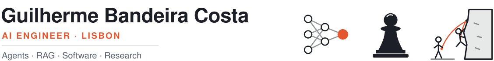

<picture>
  <source media="(prefers-color-scheme: dark)" srcset="./assets/header-dark.svg">
  
</picture>

I got into AI because it's the closest thing we have to building a mind and watching how it thinks. I spent the last two years at [Affine](https://affine.law) teaching one to read the law: finding the right passage in a mountain of legal documents, and knowing when an answer can actually be trusted.

### Featured

-  **[The Role of Positional Encodings in the ARC Benchmark](https://arxiv.org/abs/2502.00174)** — first-author paper on how positional encoding choices change what Transformers can reason about on abstract grid tasks. [Code](https://github.com/GuiBandeiraCosta/arc-positional-encodings)
- **[Evoker](https://github.com/GuiBandeiraCosta/Evoker)** — a web recreation of my favourite childhood game, which sadly got shut down. [Play it](https://evoker.pages.dev)
- **[Arrumazém](https://arrumazem.pt)** — the website I built for our family's self-storage business in Torres Vedras.
<!-- As new projects ship (an MCP server, an agent loop, an eval harness), add them here. -->

### Stack

![OpenAI](https://img.shields.io/badge/OpenAI-412991?logo=data:image/svg+xml;base64,PHN2ZyBmaWxsPSJ3aGl0ZSIgcm9sZT0iaW1nIiB2aWV3Qm94PSIwIDAgMjQgMjQiIHhtbG5zPSJodHRwOi8vd3d3LnczLm9yZy8yMDAwL3N2ZyI+PHRpdGxlPk9wZW5BSTwvdGl0bGU+PHBhdGggZD0iTTIyLjI4MTkgOS44MjExYTUuOTg0NyA1Ljk4NDcgMCAwIDAtLjUxNTctNC45MTA4IDYuMDQ2MiA2LjA0NjIgMCAwIDAtNi41MDk4LTIuOUE2LjA2NTEgNi4wNjUxIDAgMCAwIDQuOTgwNyA0LjE4MThhNS45ODQ3IDUuOTg0NyAwIDAgMC0zLjk5NzcgMi45IDYuMDQ2MiA2LjA0NjIgMCAwIDAgLjc0MjcgNy4wOTY2IDUuOTggNS45OCAwIDAgMCAuNTExIDQuOTEwNyA2LjA1MSA2LjA1MSAwIDAgMCA2LjUxNDYgMi45MDAxQTUuOTg0NyA1Ljk4NDcgMCAwIDAgMTMuMjU5OSAyNGE2LjA1NTcgNi4wNTU3IDAgMCAwIDUuNzcxOC00LjIwNTggNS45ODk0IDUuOTg5NCAwIDAgMCAzLjk5NzctMi45MDAxIDYuMDU1NyA2LjA1NTcgMCAwIDAtLjc0NzUtNy4wNzI5em0tOS4wMjIgMTIuNjA4MWE0LjQ3NTUgNC40NzU1IDAgMCAxLTIuODc2NC0xLjA0MDhsLjE0MTktLjA4MDQgNC43NzgzLTIuNzU4MmEuNzk0OC43OTQ4IDAgMCAwIC4zOTI3LS42ODEzdi02LjczNjlsMi4wMiAxLjE2ODZhLjA3MS4wNzEgMCAwIDEgLjAzOC4wNTJ2NS41ODI2YTQuNTA0IDQuNTA0IDAgMCAxLTQuNDk0NSA0LjQ5NDR6bS05LjY2MDctNC4xMjU0YTQuNDcwOCA0LjQ3MDggMCAwIDEtLjUzNDYtMy4wMTM3bC4xNDIuMDg1MiA0Ljc4MyAyLjc1ODJhLjc3MTIuNzcxMiAwIDAgMCAuNzgwNiAwbDUuODQyOC0zLjM2ODV2Mi4zMzI0YS4wODA0LjA4MDQgMCAwIDEtLjAzMzIuMDYxNUw5Ljc0IDE5Ljk1MDJhNC40OTkyIDQuNDk5MiAwIDAgMS02LjE0MDgtMS42NDY0ek0yLjM0MDggNy44OTU2YTQuNDg1IDQuNDg1IDAgMCAxIDIuMzY1NS0xLjk3MjhWMTEuNmEuNzY2NC43NjY0IDAgMCAwIC4zODc5LjY3NjVsNS44MTQ0IDMuMzU0My0yLjAyMDEgMS4xNjg1YS4wNzU3LjA3NTcgMCAwIDEtLjA3MSAwbC00LjgzMDMtMi43ODY1QTQuNTA0IDQuNTA0IDAgMCAxIDIuMzQwOCA3Ljg3MnptMTYuNTk2MyAzLjg1NThMMTMuMTAzOCA4LjM2NCAxNS4xMTkyIDcuMmEuMDc1Ny4wNzU3IDAgMCAxIC4wNzEgMGw0LjgzMDMgMi43OTEzYTQuNDk0NCA0LjQ5NDQgMCAwIDEtLjY3NjUgOC4xMDQydi01LjY3NzJhLjc5Ljc5IDAgMCAwLS40MDctLjY2N3ptMi4wMTA3LTMuMDIzMWwtLjE0Mi0uMDg1Mi00Ljc3MzUtMi43ODE4YS43NzU5Ljc3NTkgMCAwIDAtLjc4NTQgMEw5LjQwOSA5LjIyOTdWNi44OTc0YS4wNjYyLjA2NjIgMCAwIDEgLjAyODQtLjA2MTVsNC44MzAzLTIuNzg2NmE0LjQ5OTIgNC40OTkyIDAgMCAxIDYuNjgwMiA0LjY2ek04LjMwNjUgMTIuODYzbC0yLjAyLTEuMTYzOGEuMDgwNC4wODA0IDAgMCAxLS4wMzgtLjA1NjdWNi4wNzQyYTQuNDk5MiA0LjQ5OTIgMCAwIDEgNy4zNzU3LTMuNDUzN2wtLjE0Mi4wODA1TDguNzA0IDUuNDU5YS43OTQ4Ljc5NDggMCAwIDAtLjM5MjcuNjgxM3ptMS4wOTc2LTIuMzY1NGwyLjYwMi0xLjQ5OTggMi42MDY5IDEuNDk5OHYyLjk5OTRsLTIuNTk3NCAxLjQ5OTctMi42MDY3LTEuNDk5N1oiLz48L3N2Zz4=&logoColor=white)

![AWS](https://img.shields.io/badge/AWS-232F3E?logo=data:image/svg+xml;base64,PHN2ZyBmaWxsPSJ3aGl0ZSIgcm9sZT0iaW1nIiB2aWV3Qm94PSIwIDAgMjQgMjQiIHhtbG5zPSJodHRwOi8vd3d3LnczLm9yZy8yMDAwL3N2ZyI+PHRpdGxlPkFtYXpvbiBBV1M8L3RpdGxlPjxwYXRoIGQ9Ik02Ljc2MyAxMC4wMzZjMCAuMjk2LjAzMi41MzUuMDg4LjcxLjA2NC4xNzYuMTQ0LjM2OC4yNTYuNTc2LjA0LjA2My4wNTYuMTI3LjA1Ni4xODMgMCAuMDgtLjA0OC4xNi0uMTUyLjI0bC0uNTAzLjMzNWEuMzgzLjM4MyAwIDAgMS0uMjA4LjA3MmMtLjA4IDAtLjE2LS4wNC0uMjM5LS4xMTJhMi40NyAyLjQ3IDAgMCAxLS4yODctLjM3NSA2LjE4IDYuMTggMCAwIDEtLjI0OC0uNDcxYy0uNjIyLjczNC0xLjQwNSAxLjEwMS0yLjM0NyAxLjEwMS0uNjcgMC0xLjIwNS0uMTkxLTEuNTk2LS41NzQtLjM5MS0uMzg0LS41OS0uODk0LS41OS0xLjUzMyAwLS42NzguMjM5LTEuMjMuNzI2LTEuNjQ0LjQ4Ny0uNDE1IDEuMTMzLS42MjMgMS45NTUtLjYyMy4yNzIgMCAuNTUxLjAyNC44NDYuMDY0LjI5Ni4wNC42LjEwNC45MTguMTc2di0uNTgzYzAtLjYwNy0uMTI3LTEuMDMtLjM3NS0xLjI3Ny0uMjU1LS4yNDgtLjY4Ni0uMzY3LTEuMy0uMzY3LS4yOCAwLS41NjguMDMxLS44NjMuMTAzLS4yOTUuMDcyLS41ODMuMTYtLjg2Mi4yNzJhMi4yODcgMi4yODcgMCAwIDEtLjI4LjEwNC40ODguNDg4IDAgMCAxLS4xMjcuMDIzYy0uMTEyIDAtLjE2OC0uMDgtLjE2OC0uMjQ3di0uMzkxYzAtLjEyOC4wMTYtLjIyNC4wNTYtLjI4YS41OTcuNTk3IDAgMCAxIC4yMjQtLjE2N2MuMjc5LS4xNDQuNjE0LS4yNjQgMS4wMDUtLjM2YTQuODQgNC44NCAwIDAgMSAxLjI0Ni0uMTUxYy45NSAwIDEuNjQ0LjIxNiAyLjA5MS42NDcuNDM5LjQzLjY2MiAxLjA4NS42NjIgMS45NjN2Mi41ODZ6bS0zLjI0IDEuMjE0Yy4yNjMgMCAuNTM0LS4wNDguODIyLS4xNDQuMjg3LS4wOTYuNTQzLS4yNzEuNzU4LS41MS4xMjgtLjE1Mi4yMjQtLjMyLjI3Mi0uNTEyLjA0Ny0uMTkxLjA4LS40MjMuMDgtLjY5NHYtLjMzNWE2LjY2IDYuNjYgMCAwIDAtLjczNS0uMTM2IDYuMDIgNi4wMiAwIDAgMC0uNzUtLjA0OGMtLjUzNSAwLS45MjYuMTA0LTEuMTkuMzItLjI2My4yMTUtLjM5LjUxOC0uMzkuOTE3IDAgLjM3NS4wOTUuNjU1LjI5NS44NDYuMTkxLjIuNDcuMjk2LjgzOC4yOTZ6bTYuNDEuODYyYy0uMTQ0IDAtLjI0LS4wMjQtLjMwNC0uMDgtLjA2NC0uMDQ4LS4xMi0uMTYtLjE2OC0uMzExTDcuNTg2IDUuNTVhMS4zOTggMS4zOTggMCAwIDEtLjA3Mi0uMzJjMC0uMTI4LjA2NC0uMi4xOTEtLjJoLjc4M2MuMTUxIDAgLjI1NS4wMjUuMzEuMDguMDY1LjA0OC4xMTMuMTYuMTYuMzEybDEuMzQyIDUuMjg0IDEuMjQ1LTUuMjg0Yy4wNC0uMTYuMDg4LS4yNjQuMTUxLS4zMTJhLjU0OS41NDkgMCAwIDEgLjMyLS4wOGguNjM4Yy4xNTIgMCAuMjU2LjAyNS4zMi4wOC4wNjMuMDQ4LjEyLjE2LjE1MS4zMTJsMS4yNjEgNS4zNDggMS4zODEtNS4zNDhjLjA0OC0uMTYuMTA0LS4yNjQuMTYtLjMxMmEuNTIuNTIgMCAwIDEgLjMxMS0uMDhoLjc0M2MuMTI3IDAgLjIuMDY1LjIuMiAwIC4wNC0uMDA5LjA4LS4wMTcuMTI4YTEuMTM3IDEuMTM3IDAgMCAxLS4wNTYuMmwtMS45MjMgNi4xN2MtLjA0OC4xNi0uMTA0LjI2My0uMTY4LjMxMWEuNTEuNTEgMCAwIDEtLjMwMy4wOGgtLjY4N2MtLjE1MSAwLS4yNTUtLjAyNC0uMzItLjA4LS4wNjMtLjA1Ni0uMTE5LS4xNi0uMTUtLjMybC0xLjIzOC01LjE0OC0xLjIzIDUuMTRjLS4wNC4xNi0uMDg3LjI2NC0uMTUuMzItLjA2NS4wNTYtLjE3Ny4wOC0uMzIuMDh6bTEwLjI1Ni4yMTVjLS40MTUgMC0uODMtLjA0OC0xLjIyOS0uMTQzLS4zOTktLjA5Ni0uNzEtLjItLjkxOC0uMzItLjEyOC0uMDcxLS4yMTUtLjE1MS0uMjQ3LS4yMjNhLjU2My41NjMgMCAwIDEtLjA0OC0uMjI0di0uNDA3YzAtLjE2Ny4wNjQtLjI0Ny4xODMtLjI0Ny4wNDggMCAuMDk2LjAwOC4xNDQuMDI0LjA0OC4wMTYuMTIuMDQ4LjIuMDguMjcxLjEyLjU2Ni4yMTUuODc4LjI3OS4zMTkuMDY0LjYzLjA5Ni45NS4wOTYuNTAyIDAgLjg5NC0uMDg4IDEuMTY1LS4yNjRhLjg2Ljg2IDAgMCAwIC40MTUtLjc1OC43NzcuNzc3IDAgMCAwLS4yMTUtLjU1OWMtLjE0NC0uMTUxLS40MTYtLjI4Ny0uODA3LS40MTVsLTEuMTU3LS4zNmMtLjU4My0uMTgzLTEuMDE0LS40NTQtMS4yNzctLjgxM2ExLjkwMiAxLjkwMiAwIDAgMS0uNC0xLjE1OGMwLS4zMzUuMDczLS42My4yMTYtLjg4Ni4xNDQtLjI1NS4zMzUtLjQ3OS41NzUtLjY1NC4yNC0uMTg0LjUxLS4zMi44My0uNDE1LjMyLS4wOTYuNjU1LS4xMzYgMS4wMDYtLjEzNi4xNzUgMCAuMzU5LjAwOC41MzUuMDMyLjE4My4wMjQuMzUuMDU2LjUxOC4wODguMTYuMDQuMzEyLjA4LjQ1NS4xMjcuMTQ0LjA0OC4yNTYuMDk2LjMzNi4xNDRhLjY5LjY5IDAgMCAxIC4yNC4yLjQzLjQzIDAgMCAxIC4wNzEuMjYzdi4zNzVjMCAuMTY4LS4wNjQuMjU2LS4xODQuMjU2YS44My44MyAwIDAgMS0uMzAzLS4wOTYgMy42NTIgMy42NTIgMCAwIDAtMS41MzItLjMxMWMtLjQ1NSAwLS44MTUuMDcxLTEuMDYyLjIyMy0uMjQ4LjE1Mi0uMzc1LjM4My0uMzc1LjcxIDAgLjIyNC4wOC40MTYuMjQuNTY3LjE1OS4xNTIuNDU0LjMwNC44NzcuNDRsMS4xMzQuMzU4Yy41NzQuMTg0Ljk5LjQ0IDEuMjM3Ljc2Ny4yNDcuMzI3LjM2Ny43MDIuMzY3IDEuMTE3IDAgLjM0My0uMDcyLjY1NS0uMjA3LjkyNi0uMTQ0LjI3Mi0uMzM2LjUxMS0uNTgzLjcwMy0uMjQ4LjItLjU0My4zNDMtLjg4Ni40NDctLjM2LjExMS0uNzM0LjE2Ny0xLjE0Mi4xNjd6TTIxLjY5OCAxNi4yMDdjLTIuNjI2IDEuOTQtNi40NDIgMi45NjktOS43MjIgMi45NjktNC41OTggMC04Ljc0LTEuNy0xMS44Ny00LjUyNi0uMjQ3LS4yMjMtLjAyNC0uNTI3LjI3Mi0uMzUxIDMuMzg0IDEuOTYzIDcuNTU5IDMuMTUzIDExLjg3NyAzLjE1MyAyLjkxNCAwIDYuMTE0LS42MDcgOS4wNi0xLjg1Mi40MzktLjIuODE0LjI4Ny4zODMuNjA3ek0yMi43OTIgMTQuOTYxYy0uMzM2LS40My0yLjIyLS4yMDctMy4wNzQtLjEwMy0uMjU1LjAzMi0uMjk1LS4xOTItLjA2My0uMzYgMS41LTEuMDUzIDMuOTY3LS43NSA0LjI1NC0uMzk5LjI4Ny4zNi0uMDggMi44MjYtMS40ODUgNC4wMDctLjIxNS4xODQtLjQyMy4wODgtLjMyNy0uMTUxLjMyLS43OSAxLjAzLTIuNTcuNjk1LTIuOTk0eiIvPjwvc3ZnPg==&logoColor=white)

### Beyond code

Away from the keyboard I play chess, climb, and read (currently deep in *Red Rising*). I'm also hopelessly fascinated by the brain, a rabbit hole I blame entirely on Stanislas Dehaene's *Consciousness and the Brain*.

<picture><source media="(prefers-color-scheme: dark)" srcset="./assets/icon-pawn-dark.svg"></picture>&nbsp; **Chess:** on the road to 2000 in every format. [Follow the journey](https://www.chess.com/member/profetg)

<picture><source media="(prefers-color-scheme: dark)" srcset="./assets/icon-climber-dark.svg"></picture>&nbsp; **Climbing:** working towards my first 7a.

### Elsewhere

[Website](https://guibandeiracosta.github.io/) · [LinkedIn](https://www.linkedin.com/in/guilherme-bandeira-costa-804508232/) · [Google Scholar](https://scholar.google.com/citations?hl=en&user=5lhVyIUAAAAJ) · [Chess.com](https://www.chess.com/member/profetg) · [guilherme.bandeirac@gmail.com](mailto:guilherme.bandeirac@gmail.com)
